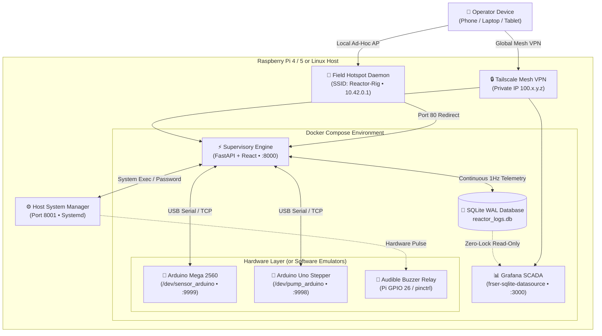

# ⚗️ Reactor Controller

<div align="center">

```
  ██████╗ ███████╗ █████╗  ██████╗████████╗ ██████╗ ██████╗ 
  ██╔══██╗██╔════╝██╔══██╗██╔════╝╚══██╔══╝██╔═══██╗██╔══██╗
  ██████╔╝█████╗  ███████║██║        ██║   ██║   ██║██████╔╝
  ██╔══██╗██╔══╝  ██╔══██║██║        ██║   ██║   ██║██╔══██╗
  ██║  ██║███████╗██║  ██║╚██████╗   ██║   ╚██████╔╝██║  ██║
  ╚═╝  ╚═╝╚══════╝╚═╝  ╚═╝ ╚═════╝   ╚═╝    ╚═════╝ ╚═╝  ╚═╝
           CONTROLLER • SCADA • TELEMETRY ENGINE
```

**Prototype Supervisory Control, Real-Time SCADA Analytics & Dual-MCU Bench Rig**
*Designed for staged, low-energy commissioning before any high-temperature use.*

---

[](https://github.com/globel420/reactor-controller)
[](https://github.com/globel420/reactor-controller)
[](https://github.com/globel420/reactor-controller)
[](https://github.com/globel420/reactor-controller)
[](https://github.com/globel420/reactor-controller)
[](https://github.com/globel420/reactor-controller)

[Quick Start](#-60-second-quick-start) • [Architecture](#-system-architecture) • [Dashboard Views](#-dual-interface-scada-vs-controls) • [Hardware Wiring](#-hardware-topology--pinout) • [Peer Review](#-engineering-peer-review--safety-guarantees) • [Roadmap](#-strategic-roadmap--recommended-next-steps) • [Setup Guide](FRIEND_SETUP_GUIDE.md)

</div>

---

## ⚡ 60-Second Quick Start

The entire stack is packaged into a sterile, zero-dependency Docker environment with **built-in hardware physics emulators**. You can test the complete system, state machine, safety interlocks, and telemetry graphs on any machine without physical hardware attached.

```bash
# 1. Clone repository
git clone https://github.com/globel420/reactor-controller.git
cd reactor-controller

# 2. Create the single runtime/wiring configuration
cp .env.example .env

# 3. Apply the selected profile
./scripts/apply_profile.sh
```

The root `.env` is the only operator-edited mode and pin file. Keep
`COMPOSE_PROFILES=simulation` for emulators. After the Pi, both MCUs, GPIO,
firmware, and physical safety hardware are commissioned, change that one value
to `COMPOSE_PROFILES=hardware` and run `./scripts/apply_profile.sh`. The helper
tears down services from both profiles before bringing up exactly the selected
stack. MCU pin changes in `.env` are compile-time inputs and require
rebuilding/flashing that MCU. Hardware readiness compares target-specific
firmware fingerprints reported by the Mega and Uno with the selected `.env`;
stale or differently wired firmware is rejected.
Simulation state is stored under `data/simulation`; physical telemetry,
alarm limits, and the persistent safety latch live only under `data/hardware`.
The profile helper refuses to silently reuse a legacy shared database.

### Access URLs

| Interface | Port | Credentials | Purpose |
|---|---|---|---|
| **🎛️ Machine Controls & Settings** | [`http://localhost:8000`](http://localhost:8000) | *None (Trusted Network Only)* | Active state control, setpoints, pump dosing, scale tare, host shell |
| **📊 Embedded SCADA Analytics** | [`http://localhost:8000`](http://localhost:8000) *(Tab 2)* | *Anonymous Admin* | Live 1s dark cyberpunk SCADA operator console inside control panel |
| **📈 Standalone Grafana Suite** | [`http://localhost:3000`](http://localhost:3000) | `admin` / `admin` | Full-screen telemetry, historical runs, and custom dashboard creator |

> [!TIP]
> **Deploying to a Raspberry Pi?** Check out the step-by-step [**Friend Setup Guide (FRIEND_SETUP_GUIDE.md)**](FRIEND_SETUP_GUIDE.md) covering headless Pi 4/5 setup, automatic field Wi-Fi hotspots, and zero-port-forwarding remote access via Tailscale.

> [!WARNING]
> The preserved browser shell, password, and actuation endpoints are unauthenticated.
> Use this prototype only on an isolated trusted LAN/hotspot or Tailnet; do not
> expose ports 80, 8000, 8001, or 3000 to the public WAN or an untrusted LAN.

---

## 🎛️ Dual-Interface: Controls vs. SCADA

The web application features an in-app view switcher allowing operators to transition seamlessly between physical machine actuation and telemetry:

```
  ┌────────────────────────────────────────────────────────────────────────┐
  │ ⚗️ Reactor Controller               [ 🎛️ Controls ] [ 📊 SCADA Analytics ] │
  └────────────────────────────────────────────────────────────────────────┘
```

### 1. 🎛️ Active Machine Controls (`:8000`)
* **State Machine Sequencer**: Single-click transitions between `STANDBY` (0), `WARMUP` (1), and `WORKING` (2) with automatic temperature stabilization checks.
* **Closed-Loop Thermal Zones**: Independent setpoint and ramp rate control for:
  * Feedstock Preheater
  * Liquid Reactor Core
  * Gas Headspace Reactor
* **Precision Feedstock Dosing**: Stepper motor pump RPM controls with automated gravimetric dosing rate feedback.
* **Safety & Hardware Interlocks**:
  * Real-time MAX31865 RTD error decoding (open sensor, over/under-voltage, RTDIn- fault).
  * 1-click software **EMERGENCY STOP (E-STOP)** that latches the supervisor and commands both MCUs to their safe state; independent physical power removal remains mandatory.
* **Host Administration Modal**:
  * **Interactive Terminal Shell**: Run host maintenance commands (`tailscale status`, `docker compose ps`, `free -h`) directly in the browser.
  * **Configured Buzzer Relay Pulse**: Test the `.env`-selected audible alarm output with a 1.5s hardware trigger.
  * **Web Password Manager**: Change host credentials without an SSH terminal; this is an accepted unauthenticated, trusted-network-only risk.

### 2. 📊 High-Density SCADA Operator Console (`:8000` & `:3000`)
* **Operator SCADA View** (`reactor-operator-scada`):
  * **6 Real-Time KPI Cards**: Neon state indicator, Liquid Core °C, Gas Headspace °C, Preheater °C, Dosing Rate (g/min), and Total Energy (kWh).
  * **Area Waveform Visualizers**: High-contrast gradient curves comparing liquid, gas core, and preheater temperatures against time.
  * **Multi-Zone Limit Gauges**: Color-coded limit gauges displaying current temperature vs maximum safety thresholds.
  * **Heater PWM Duty Cycle Breakdown**: Stacked visualizer displaying power output (0–100%) across all three heating elements.
  * **Gravimetric Depletion Curve**: Real-time mass depletion of the reagent reservoir.
  * **MQ-8 Hydrogen Advisory Gauge**: Displays the uncalibrated sensor estimate for characterization only; it is not a gas alarm or certified interlock.
  * **Live Audit Event Log**: Instant audit table querying `error_logs` in real time.
* **Detailed Telemetry & Engineering Analytics** (`reactor-telemetry`):
  * Multi-hour operational trends, historical run comparison overlays, and 1m/10m rollups.

---

## 📐 System Architecture



---

## 📊 High-Concurrency Telemetry Engine

The system uses an optimized SQLite time-series storage pipeline:

* **WAL Mode Execution (`PRAGMA journal_mode = WAL`)**: Writers never block readers. Supervisory writes 1-second telemetry concurrently while Grafana executes high-frequency queries.
* **Continuous Real-Time Streaming**: Telemetry is written continuously (1 row/sec) across **all states** (`STANDBY`, `WARMUP`, `WORKING`), ensuring live dashboards and waveforms never suffer from "No data" drops.
* **Hierarchical Downsampling Rollups**:
  * `logs_1s`: Raw 1Hz data (24-hour high-resolution retention).
  * `logs_1m`: 1-minute averaged rollups for operational shifts (30-day retention).
  * `logs_10m`: 10-minute downsampled data for permanent archive.
* **Batch Run Partitioning (`runs_metadata`)**: Starting a new run archives the previous run with full summary statistics (total energy kWh, reagent mass consumed, run duration) without deleting raw historical logs.

---

## 🔌 Hardware Topology & Pinout

```
                           ┌───────────────────────────────┐
                           │    Raspberry Pi 4 / Pi 5      │
                           │  - Docker Supervisory (:8000) │
                           │  - Grafana SCADA     (:3000) │
                           │  - Host System Mgr   (:8001) │
                           └──┬──────────────┬───────────┬─┘
                              │ USB          │ USB       │ GPIO 26
               ┌──────────────┘              │           └───────────┐
               ▼                             ▼                       ▼
    ┌────────────────────┐        ┌────────────────────┐     ┌───────────────┐
    │ Arduino Mega 2560  │        │   Arduino Uno R3   │     │ Audible Alert │
    │ Sensors & Heaters  │        │ Stepper Motor Pump │     │  Relay Module │
    └─┬──────┬──────┬────┘        └──────────┬─────────┘     └───────────────┘
      │      │      │                        │
      ▼      ▼      ▼                        ▼
    RTDs    SSRs   MQ-8                    TB6600
   MAX31865 PWM    Gas                    Driver &
   Sensors Coils  Sensor                 Peristaltic
```

### Sensor & Actuator Pin Assignments

`.env` is the wiring source of truth. The defaults below match the current
firmware build; edit the named variable before building if the physical rig is
wired differently.

| Channel | Sensor / Actuator | Controller | Interface / Pin | Notes |
|---|---|---|---|---|
| **Feedstock Preheater** | PT100 RTD (MAX31865) | Arduino Mega | `MEGA_PIN_RTD_PREHEATER=40` | 3-wire RTD |
| **Liquid Reactor Core** | PT100 RTD (MAX31865) | Arduino Mega | `MEGA_PIN_RTD_LIQUID=42` | 3-wire RTD |
| **Gas Headspace (Int)** | PT100 RTD (MAX31865) | Arduino Mega | `MEGA_PIN_RTD_GAS_INT=44` | 3-wire RTD |
| **Gas Headspace (Ext)** | PT100 RTD (MAX31865) | Arduino Mega | `MEGA_PIN_RTD_GAS_EXT=46` | 3-wire RTD |
| **Feed Reservoir** | MAX31855 thermocouple | Arduino Mega | `MEGA_PIN_TC_FEED_RES=38` | Software SPI |
| **Electronics Housing** | MAX31855 thermocouple | Arduino Mega | `MEGA_PIN_TC_HOUSING=36` | Software SPI |
| **Feed Tank Weight** | HX711 load cell | Arduino Mega | `MEGA_PIN_HX711_DT=3`, `MEGA_PIN_HX711_SCK=2` | Gravimetric balance |
| **H2 Monitor** | MQ-8 analog signal | Arduino Mega | `MEGA_PIN_H2_SENSOR=A0` | Requires calibration; not a certified gas interlock |
| **Heater 1 (Preheat)** | SSR | Arduino Mega | `MEGA_PIN_HEATER_PREHEATER=6` | 1-second time-proportional PID |
| **Heater 2 (Liquid)** | SSR | Arduino Mega | `MEGA_PIN_HEATER_LIQUID=8` | 1-second time-proportional PID |
| **Heater 3 (Gas)** | SSR | Arduino Mega | `MEGA_PIN_HEATER_GAS=9` | 1-second time-proportional PID |
| **Dosing Pump** | TB6600 | Arduino Uno | `UNO_PIN_ENABLE=8`, `UNO_PIN_STEP=9`, `UNO_PIN_DIRECTION=10` | 1000 steps/rev; 240 RPM ceiling |
| **Audible Alarm** | 5V buzzer relay | Raspberry Pi | `PI_BUZZER_GPIO=26` | Hardware mode refuses mock GPIO |

---

## 🔒 Field Wi-Fi & Tailscale Remote Access

### 1. Zero-Config Remote Access (Tailscale)
Connect your rig securely to your private devices without opening router ports or paying for static public IPs:
```bash
# On the Raspberry Pi:
sudo tailscale up
```
Once connected, access the rig securely from anywhere at `http://<your-tailscale-ip>:8000` or `http://<your-tailscale-ip>:3000`.

### 2. Standalone Field Wi-Fi Hotspot
When operating out in the field without an internet connection:
* The Pi automatically creates the WPA2-protected **`Reactor-Rig`** network configured by `setup_pi.sh`.
* Connect from your phone, tablet, or laptop.
* Open your browser and navigate to `http://10.42.0.1` — the built-in HTTP redirector automatically forwards you directly to the `:8000` supervisory control interface.

---

## 🧪 Testing & Verification

The test suite covers end-to-end state transitions, PID safety limits, sensor error handling, downsampling rollups, and API routes:

```bash
# Run complete supervisory test suite
PYTHONPATH=. pytest supervisory/tests scripts/tests -v
```

```text
======================= 103 passed =======================
```

---

## 🔍 Engineering Safety Controls and Proof Boundary

The software implements the controls below, but physical commissioning still
requires measured low-energy HIL evidence and independent power-removal hardware.

```
┌────────────────────────────────────────────────────────────────────────┐
│                      CORE SAFETY INTERLOCK MATRIX                      │
├─────────────────────────┬─────────────────────────┬────────────────────┤
│ Trigger Event           │ System Reaction         │ Latched Action     │
├─────────────────────────┼─────────────────────────┼────────────────────┤
│ Software E-STOP         │ Command both MCUs safe  │ Buzzer + audit log │
│ RTD Sensor Open/Fault   │ Mega FAULT / heaters off│ Explicit safe reset│
│ Serial Link Loss (3s)   │ Local MCU watchdogs     │ Outputs disabled   │
│ Invalid MCU state       │ Latched safe state      │ Explicit reset     │
│ Setpoint Deviation >15°C│ Warmup Progress Blocked │ Operator Hold Wait │
└─────────────────────────┴─────────────────────────┴────────────────────┘
```

* **Deterministic 3-State Finite State Machine (FSM)**:
  * Strict monotonic validation between `STANDBY` (0), `WARMUP` (1), and `WORKING` (2).
  * Automatic progression from Warmup to Working occurs **only** when all active thermal zones stabilize within $\pm 5.0^\circ\text{C}$ of setpoint for $\ge 5.0$ continuous seconds.
  * Any unhandled exception, unrecognized state code, or sensor communication dropout forces an instantaneous, non-blocking retreat back to `STANDBY`.
* **Hardware Watchdogs & Loss-of-Comm Failsafe**:
  * The Pi sends independent 1Hz heartbeat streams to the Mega and Uno.
  * After 3.0 seconds without a valid heartbeat, the Mega latches heater FAULT while active and the Uno independently disables the active-low TB6600 enable output while running.
  * Safety-relevant Mega commands use correlated request IDs and application-level ACK/NACK responses; a successful serial write alone is never reported as an applied command.
  * The supervisory safety latch commands both MCUs safe, inhibits automatic dosing, activates the buzzer, persists the trip, and requires an explicit safe reset.
  * High-temperature trips are evaluated even in STANDBY. Reset and heater re-arm require every thermal channel to cool below its configured high limit by `SAFETY_RESET_HYSTERESIS_C` (default `2.0 C`), and a new trip racing with reset always wins.
* **Zero-Lock High-Concurrency Storage (SQLite WAL)**:
  * Configured with `PRAGMA journal_mode = WAL`, `PRAGMA synchronous = NORMAL`, and `PRAGMA busy_timeout = 5000`.
  * Writers (FastAPI 1Hz telemetry ingestion) never block concurrent readers (Grafana SCADA telemetry engine), eliminating database locks on embedded ARM flash storage.
* **MAX31865 Hardware Diagnostics & Fault Decoding**:
  * Real-time bitmask decoding of the MAX31865 fault register (`0x07`):
    * **Bit 7**: $V_{BIAS}$ High / Low Threshold Fault.
    * **Bit 6**: RTD In- High / Low Fault ($< 0.85 \times V_{BIAS}$).
    * **Bit 5**: RTD In- Voltage Open Sensor Fault.
    * **Bit 4**: RTD In+ Voltage Open Sensor Fault.
    * **Bit 2**: Over-Voltage / Under-Voltage Fault.
  * Faults are timestamped into `error_logs` and broadcasted via WebSockets in real time.
* **Load-Cell Dosing Interlock**:
  * HX711 readiness and calibration are separate firmware states. Missing or uncalibrated weight is displayed as unavailable, never as `0.000 kg`.
  * Calibration is STANDBY-only and requires a successful current-session tare; automatic dosing stays disabled until a versioned, checksummed kg calibration is valid.
* **Software Emergency Stop (E-STOP)**:
  * The UI/API latches a trip, requests Mega STANDBY, commands Uno STOP, disables automatic dosing, activates the configured buzzer, and persists an audit event.
  * A hardwired, normally-closed E-STOP/contactor that removes actuator energy remains mandatory before commissioning; software is not a substitute for that circuit.
* **Current Low-Temperature Boundary**:
  * Low-temperature conditions in `WORKING` are advisory UI/audible alarms; they do not currently latch the reactor or interlock dosing.
  * Do not commission automatic dosing until the authoritative process-safety specification decides whether each low limit must inhibit the pump.

---

## 🚀 Strategic Roadmap & Recommended Next Steps

Prioritized milestones for an actual physical deployment:

| Priority | Milestone | Technical Scope | Target Deliverable |
|---|---|---|---|
| **P1** | **Confirm `.env` wiring map** | Continuity-check every sensor, SSR, TB6600, USB identity, and GPIO against `.env`. | Signed pin/device checklist and successful firmware builds using the exact production `.env`. |
| **P2** | **Physical safety hardware** | Normally-closed E-STOP, heater contactor, SSR gate pull-downs, pump-enable pull-up, and correctly rated protection. | Actuator energy is removed independently of Pi, browser, and MCU software. |
| **P3** | **Sensor calibration** | Calibrate RTDs/load cell and characterize MQ-8 output without treating its raw estimate as certified ppm. | Stored calibration evidence and tested fault limits. |
| **P4** | **Low-energy HIL matrix** | Dummy loads for boot/reset, cable loss, sensor faults, watchdogs, reconnect, and E-STOP. | Measured SSR-off, Uno-disabled, buzzer-on, and latched-event evidence for every fault. |
| **P5** | **Headless Pi acceptance** | Raspberry Pi OS Lite 64-bit Trixie, hardware Compose profile, health checks, retention, backup/restore, and reboot recovery. | Two-service production stack healthy with no emulator process or port. |
| **P6** | **Controlled commissioning** | Begin at low energy and increase only after every prior gate remains green. | Approved physical operating envelope and rollback procedure. |

Recipes, outbound alert integrations, PID autotuning, and Agentic/OpenClaw autonomy are intentionally outside this roadmap.

---

## 📚 Repository Map

```
reactor-controller/
├── docker-compose.yml             # Full-stack Docker service definitions
├── FRIEND_SETUP_GUIDE.md          # Comprehensive step-by-step setup guide
├── README.md                      # Primary project documentation
├── host/
│   ├── system_manager.py          # Host systemd daemon (Wi-Fi, shell, buzzer)
│   └── reactor-system-manager.service
├── grafana/
│   └── provisioning/
│       ├── datasources/sqlite.yaml # Auto-configured SQLite datasource
│       └── dashboards/
│           ├── reactor_operator_scada.json # Alternative SCADA console
│           └── reactor_telemetry.json      # Engineering analytics dashboard
├── supervisory/
│   ├── Dockerfile
│   ├── requirements.txt
│   ├── app/
│   │   ├── main.py                # FastAPI routes & WebSocket hub
│   │   ├── orchestrator.py        # Safety state machine & continuous logger
│   │   ├── database.py            # SQLite schema (1s, 1m, 10m rollups)
│   │   ├── crud.py                # Analytics calculations & downsampling
│   │   └── static/index.html      # Control panel UI & embedded SCADA
│   └── tests/                     # 24 unit & integration tests
├── emulators/
│   ├── sensor_emulator.py         # Mega 2560 thermal physics simulator
│   └── pump_emulator.py           # Uno stepper motor simulator
└── documents/
    ├── reactor_hardware_infographic.html # Interactive verification checklist
    └── RTD_MIGRATION_PLAN.md             # Hardware migration specification
```

---

## 📜 License

Distributed under the MIT License. See `LICENSE` for more information.
