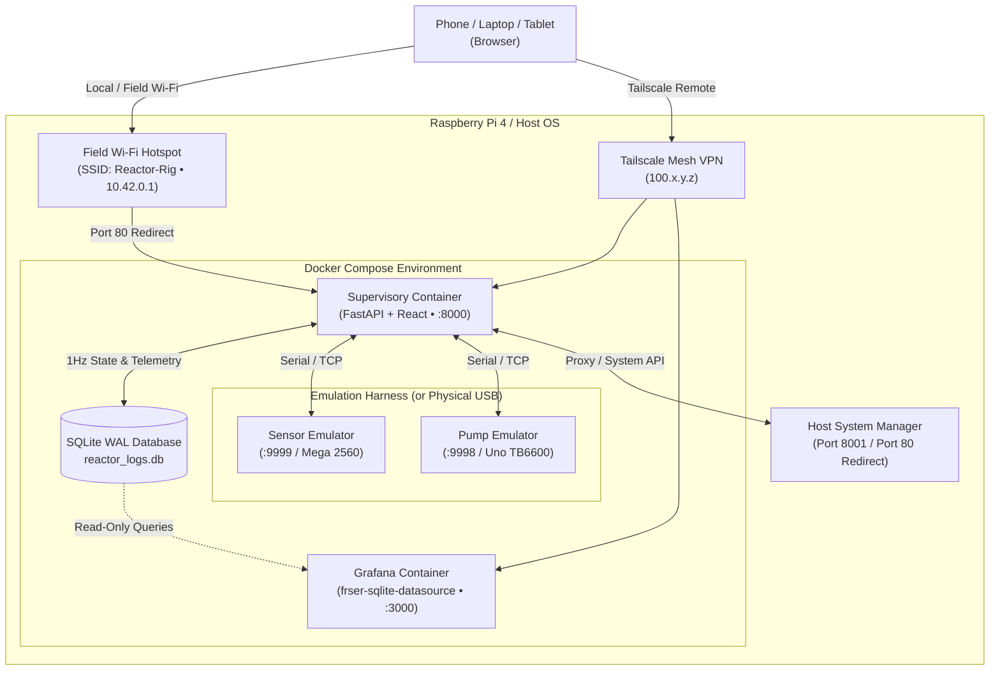

# Reactor Controller

A high-reliability supervisory control, automated telemetry, and process analytics system for chemical & supercritical bench reactors.

Designed for headless deployment on **Raspberry Pi 4/5** or any Linux host with **Docker Compose**, with support for local browser control, field ad-hoc Wi-Fi, and global access via **Tailscale VPN**.


---

## ⚡ Quick Start

Get the entire system running with live hardware emulators in 60 seconds:

```bash
git clone https://github.com/globel420/reactor-controller.git
cd reactor-controller
docker compose up -d --build
```

* **Supervisory Web Control Panel**: Open [http://localhost:8000](http://localhost:8000)
* **Grafana Process Analytics Dashboard**: Open [http://localhost:3000](http://localhost:3000)

👉 **For step-by-step setup, personal Tailscale VPN configuration, and field Wi-Fi setup, see [FRIEND_SETUP_GUIDE.md](FRIEND_SETUP_GUIDE.md).**

---

## 🌟 Key Features

* **Real-Time Supervisory Control Panel (`supervisory`)**:
  * PID closed-loop heating zones (Preheater, Liquid Core, Gas Headspace).
  * Stepper motor dosing pump control with automated flow rate calculation.
  * Automated sequence engine with multi-stage recipes and holds.
  * Multi-tier safety interlocks, thermal runaway cutoffs, and hardware watchdog heartbeats.
  * Single-click emergency stop (`E-STOP`).

* **High-Concurrency Telemetry Pipeline**:
  * Single-file SQLite database with **WAL mode** (`PRAGMA journal_mode = WAL`) enabling concurrent 1Hz telemetry streaming without locking readers.
  * Multi-run isolation (`run_id`) preserving full historical experiment telemetry forever.
  * Automated 1-minute and 10-minute rollup downsampling with automated retention pruning.
  * Instant CSV export of individual experiment runs.

* **Embedded Grafana 13 Analytics**:
  * Thermal ramp rates (°C/min) with derivative tracking.
  * Continuous gravimetric mass flow dosing rates (g/min).
  * Cumulative heater electrical energy consumption (kWh).
  * Historical run comparison overlays.

* **Field Wi-Fi & Remote Access**:
  * **Open Field Hotspot (`Reactor-Rig`)**: Auto-broadcasts open Wi-Fi on `10.42.0.1` when operating away from the lab.
  * **Port 80 Captive Redirect**: Any phone or tablet connecting to the hotspot can simply browse to `10.42.0.1` and is immediately redirected to `:8000`.
  * **Safe Reconnect Protection**: Built-in anti-lockout automatically restores the hotspot if joining an external Wi-Fi network fails.
  * **Zero-Config Remote Access via Tailscale**: Access your rig securely from anywhere across the globe over a private mesh VPN without opening firewall ports.

* **Dual Hardware Emulators (`emulators`)**:
  * Built-in software physics simulators allow full testing, sequence rehearsal, and dashboard development without physical hardware attached.

---

## 📐 Architecture



---

## 📄 Documentation

* [Quickstart & Tailscale Setup Guide](FRIEND_SETUP_GUIDE.md)
* [Physical Hardware Wiring & Sensors](documents/RTD_MIGRATION_PLAN.md)
* [Interactive Hardware & Topology Checklist](documents/reactor_hardware_infographic.html)
* [Detailed Installation Guide](INSTALL.md)

---

## 📜 License

MIT License.
