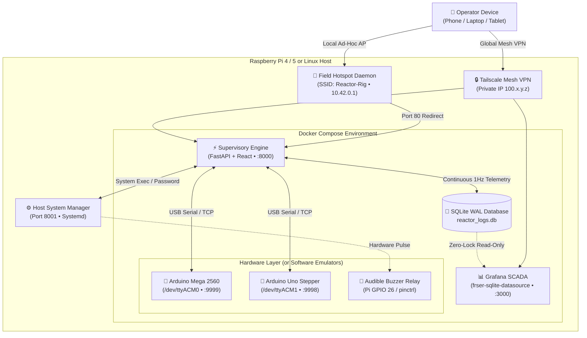

# ⚗️ Reactor Controller

<div align="center">

```
  ██████╗ ███████╗ █████╗  ██████╗████████╗ ██████╗ ██████╗ 
  ██╔══██╗██╔════╝██╔══██╗██╔════╝╚══██╔══╝██╔═══██╗██╔══██╗
  ██████╔╝█████╗  ███████║██║        ██║   ██║   ██║██████╔╝
  ██╔══██╗██╔══╝  ██╔══██║██║        ██║   ██║   ██║██╔══██╗
  ██║  ██║███████╗██║  ██║╚██████╗   ██║   ╚██████╔╝██║  ██║
  ╚═╝  ╚═╝╚══════╝╚═╝  ╚═╝ ╚═════╝   ╚═╝    ╚═════╝ ╚═╝  ╚═╝
           CONTROLLER • SCADA • TELEMETRY ENGINE
```

**Industrial-grade Supervisory Control, Real-Time SCADA Analytics & Dual-MCU Hardware Rig**  
*Engineered for high-temperature & supercritical bench reactor systems.*

---

[](https://github.com/globel420/reactor-controller)
[](https://github.com/globel420/reactor-controller)
[](https://github.com/globel420/reactor-controller)
[](https://github.com/globel420/reactor-controller)
[](https://github.com/globel420/reactor-controller)
[](https://github.com/globel420/reactor-controller)

[Quick Start](#-60-second-quick-start) • [Architecture](#-system-architecture) • [Dashboard Views](#-dual-interface-scada-vs-controls) • [Hardware Wiring](#-hardware-topology--pinout) • [Peer Review](#-engineering-peer-review--safety-guarantees) • [Roadmap](#-strategic-roadmap--recommended-next-steps) • [Setup Guide](FRIEND_SETUP_GUIDE.md)

</div>

---

## ⚡ 60-Second Quick Start

The entire stack is packaged into a sterile, zero-dependency Docker environment with **built-in hardware physics emulators**. You can test the complete system, state machine, safety interlocks, and telemetry graphs on any machine without physical hardware attached.

```bash
# 1. Clone repository
git clone https://github.com/globel420/reactor-controller.git
cd reactor-controller

# 2. Launch Docker stack (Supervisory + Grafana + Physics Emulators)
docker compose up -d --build
```

### Access URLs

| Interface | Port | Credentials | Purpose |
|---|---|---|---|
| **🎛️ Machine Controls & Settings** | [`http://localhost:8000`](http://localhost:8000) | *None (Open LAN)* | Active state control, setpoints, pump dosing, scale tare, host shell |
| **📊 Embedded SCADA Analytics** | [`http://localhost:8000`](http://localhost:8000) *(Tab 2)* | *Anonymous Admin* | Live 1s dark cyberpunk SCADA operator console inside control panel |
| **📈 Standalone Grafana Suite** | [`http://localhost:3000`](http://localhost:3000) | `admin` / `admin` | Full-screen telemetry, historical runs, and custom dashboard creator |

> [!TIP]
> **Deploying to a Raspberry Pi?** Check out the step-by-step [**Friend Setup Guide (FRIEND_SETUP_GUIDE.md)**](FRIEND_SETUP_GUIDE.md) covering headless Pi 4/5 setup, automatic field Wi-Fi hotspots, and zero-port-forwarding remote access via Tailscale.

---

## 🎛️ Dual-Interface: Controls vs. SCADA

The web application features an in-app view switcher allowing operators to transition seamlessly between physical machine actuation and telemetry:

```
  ┌────────────────────────────────────────────────────────────────────────┐
  │ ⚗️ Reactor Controller               [ 🎛️ Controls ] [ 📊 SCADA Analytics ] │
  └────────────────────────────────────────────────────────────────────────┘
```

### 1. 🎛️ Active Machine Controls (`:8000`)
* **State Machine Sequencer**: Single-click transitions between `STANDBY` (0), `WARMUP` (1), and `WORKING` (2) with automatic temperature stabilization checks.
* **Closed-Loop Thermal Zones**: Independent setpoint and ramp rate control for:
  * Feedstock Preheater
  * Liquid Reactor Core
  * Gas Headspace Reactor
* **Precision Feedstock Dosing**: Stepper motor pump RPM controls with automated gravimetric dosing rate feedback.
* **Safety & Hardware Interlocks**:
  * Real-time MAX31865 RTD error decoding (open sensor, over/under-voltage, RTDIn- fault).
  * 1-click **EMERGENCY STOP (E-STOP)** immediately disengaging all solid-state relays (SSRs) and halting motors.
* **Host Administration Modal**:
  * **Interactive Terminal Shell**: Run host maintenance commands (`tailscale status`, `docker compose ps`, `free -h`) directly in the browser.
  * **GPIO 26 Relay Pulse**: Test physical audible alarms with a 1.5s hardware trigger.
  * **Web Password Manager**: Change host credentials safely without SSH terminal access.

### 2. 📊 High-Density SCADA Operator Console (`:8000` & `:3000`)
* **Operator SCADA View** (`reactor-operator-scada`):
  * **6 Real-Time KPI Cards**: Neon state indicator, Liquid Core °C, Gas Headspace °C, Preheater °C, Dosing Rate (g/min), and Total Energy (kWh).
  * **Area Waveform Visualizers**: High-contrast gradient curves comparing liquid, gas core, and preheater temperatures against time.
  * **Multi-Zone Limit Gauges**: Color-coded limit gauges displaying current temperature vs maximum safety thresholds.
  * **Heater PWM Duty Cycle Breakdown**: Stacked visualizer displaying power output (0–100%) across all three heating elements.
  * **Gravimetric Depletion Curve**: Real-time mass depletion of the reagent reservoir.
  * **MQ-8 Hydrogen Safety Gauge**: Dynamic gas concentration dial with cautionary threshold alarms.
  * **Live Audit Event Log**: Instant audit table querying `error_logs` in real time.
* **Detailed Telemetry & Engineering Analytics** (`reactor-telemetry`):
  * Multi-hour operational trends, historical run comparison overlays, and 1m/10m rollups.

---

## 📐 System Architecture



---

## 📊 High-Concurrency Telemetry Engine

The system uses an optimized SQLite time-series storage pipeline:

* **WAL Mode Execution (`PRAGMA journal_mode = WAL`)**: Writers never block readers. Supervisory writes 1-second telemetry concurrently while Grafana executes high-frequency queries.
* **Continuous Real-Time Streaming**: Telemetry is written continuously (1 row/sec) across **all states** (`STANDBY`, `WARMUP`, `WORKING`), ensuring live dashboards and waveforms never suffer from "No data" drops.
* **Hierarchical Downsampling Rollups**:
  * `logs_1s`: Raw 1Hz data (24-hour high-resolution retention).
  * `logs_1m`: 1-minute averaged rollups for operational shifts (30-day retention).
  * `logs_10m`: 10-minute downsampled data for permanent archive.
* **Batch Run Partitioning (`runs_metadata`)**: Starting a new run archives the previous run with full summary statistics (total energy kWh, reagent mass consumed, run duration) without deleting raw historical logs.

---

## 🔌 Hardware Topology & Pinout

```
                           ┌───────────────────────────────┐
                           │    Raspberry Pi 4 / Pi 5      │
                           │  - Docker Supervisory (:8000) │
                           │  - Grafana SCADA     (:3000) │
                           │  - Host System Mgr   (:8001) │
                           └──┬──────────────┬───────────┬─┘
                              │ USB          │ USB       │ GPIO 26
               ┌──────────────┘              │           └───────────┐
               ▼                             ▼                       ▼
    ┌────────────────────┐        ┌────────────────────┐     ┌───────────────┐
    │ Arduino Mega 2560  │        │   Arduino Uno R3   │     │ Audible Alert │
    │ Sensors & Heaters  │        │ Stepper Motor Pump │     │  Relay Module │
    └─┬──────┬──────┬────┘        └──────────┬─────────┘     └───────────────┘
      │      │      │                        │
      ▼      ▼      ▼                        ▼
    RTDs    SSRs   MQ-8                    TB6600
   MAX31865 PWM    Gas                    Driver &
   Sensors Coils  Sensor                 Peristaltic
```

### Sensor & Actuator Pin Assignments

| Channel | Sensor / Actuator | Controller | Interface / Pin | Notes |
|---|---|---|---|---|
| **Feedstock Preheater** | PT100 RTD (MAX31865) | Arduino Mega | Hardware SPI (CS Pin 53) | 3-Wire RTD, 430Ω Ref |
| **Liquid Reactor Core** | PT100 RTD (MAX31865) | Arduino Mega | Hardware SPI (CS Pin 49) | 3-Wire RTD, Core Thermal Probe |
| **Gas Headspace (Int)** | PT100 RTD (MAX31865) | Arduino Mega | Hardware SPI (CS Pin 48) | Internal vapor thermocouple/RTD |
| **Gas Headspace (Ext)** | PT100 RTD (MAX31865) | Arduino Mega | Hardware SPI (CS Pin 47) | Reactor exterior thermal jacket |
| **Feed Reservoir** | PT100 RTD (MAX31865) | Arduino Mega | Hardware SPI (CS Pin 46) | Ambient feedstock tank temperature |
| **Feed Tank Weight** | HX711 Load Cell | Arduino Mega | Pins A2 (DAT) / A3 (CLK) | Gravimetric balance (grams) |
| **H2 Concentration** | MQ-8 Gas Sensor | Arduino Mega | Pin A0 (Analog) | Hydrogen ppm safety detection |
| **Heater 1 (Preheat)** | Solid State Relay (SSR) | Arduino Mega | Pin 4 (PWM 490Hz) | Closed-loop PID duty cycle |
| **Heater 2 (Liquid)** | Solid State Relay (SSR) | Arduino Mega | Pin 5 (PWM 490Hz) | Closed-loop PID duty cycle |
| **Heater 3 (Gas)** | Solid State Relay (SSR) | Arduino Mega | Pin 6 (PWM 490Hz) | Closed-loop PID duty cycle |
| **Dosing Pump** | TB6600 Stepper Driver | Arduino Uno | Pins 8 (EN), 9 (DIR), 10 (CLK) | Peristaltic flow (1000 steps/rev) |
| **Audible Alarm** | 5V Buzzer Relay | Raspberry Pi | **GPIO 26** (Pin 37) | Active-high hardware trigger |

---

## 🔒 Field Wi-Fi & Tailscale Remote Access

### 1. Zero-Config Remote Access (Tailscale)
Connect your rig securely to your private devices without opening router ports or paying for static public IPs:
```bash
# On the Raspberry Pi:
sudo tailscale up
```
Once connected, access the rig securely from anywhere at `http://<your-tailscale-ip>:8000` or `http://<your-tailscale-ip>:3000`.

### 2. Standalone Field Wi-Fi Hotspot
When operating out in the field without an internet connection:
* The Pi automatically creates an open Wi-Fi network: **`Reactor-Rig`**.
* Connect from your phone, tablet, or laptop.
* Open your browser and navigate to `http://10.42.0.1` — the built-in HTTP redirector automatically forwards you directly to the `:8000` supervisory control interface.

---

## 🧪 Testing & Verification

The test suite covers end-to-end state transitions, PID safety limits, sensor error handling, downsampling rollups, and API routes:

```bash
# Run complete supervisory test suite
docker exec -it reactor_supervisory pytest /app/supervisory/tests -v
```

```text
======================= 24 passed in 2.48s =======================
```

---

## 🔍 Engineering Peer Review & Safety Guarantees

This architecture has been engineered for high-temperature chemical reactor operations where hardware reliability, deterministic fail-safes, and zero-loss telemetry are mandatory.

```
┌────────────────────────────────────────────────────────────────────────┐
│                      CORE SAFETY INTERLOCK MATRIX                      │
├─────────────────────────┬─────────────────────────┬────────────────────┤
│ Trigger Event           │ System Reaction         │ Latched Action     │
├─────────────────────────┼─────────────────────────┼────────────────────┤
│ E-STOP Button Pressed   │ Instant SSR Zero (0%)   │ GPIO 26 Siren ON   │
│ RTD Sensor Open/Fault   │ Auto-Retreat to STANDBY │ Error Audit Logged │
│ Serial Link Loss (>3s)  │ Hardware PWM Clamp (0%) │ Motor EN Disabled  │
│ MQ-8 Gas Spike (>300ppm)│ Liquid Heating Halted   │ Visual Alert Pulse │
│ Setpoint Deviation >15°C│ Warmup Progress Blocked │ Operator Hold Wait │
└─────────────────────────┴─────────────────────────┴────────────────────┘
```

* **Deterministic 3-State Finite State Machine (FSM)**:
  * Strict monotonic validation between `STANDBY` (0), `WARMUP` (1), and `WORKING` (2).
  * Automatic progression from Warmup to Working occurs **only** when all active thermal zones stabilize within $\pm 5.0^\circ\text{C}$ of setpoint for $\ge 5.0$ continuous seconds.
  * Any unhandled exception, unrecognized state code, or sensor communication dropout forces an instantaneous, non-blocking retreat back to `STANDBY`.
* **Hardware Watchdog & Loss-of-Comm Failsafe**:
  * Bidirectional 1Hz heartbeat stream between Raspberry Pi supervisory daemon and Arduino Mega firmware.
  * If the serial packet stream drops for $> 3.0\,\text{s}$, the Mega firmware independently clamps all heater SSR duty cycles to 0%, disengages the Uno stepper driver `EN` line, and trips the local alarm.
* **Zero-Lock High-Concurrency Storage (SQLite WAL)**:
  * Configured with `PRAGMA journal_mode = WAL`, `PRAGMA synchronous = NORMAL`, and `PRAGMA busy_timeout = 5000`.
  * Writers (FastAPI 1Hz telemetry ingestion) never block concurrent readers (Grafana SCADA telemetry engine), eliminating database locks on embedded ARM flash storage.
* **MAX31865 Hardware Diagnostics & Fault Decoding**:
  * Real-time bitmask decoding of the MAX31865 fault register (`0x07`):
    * **Bit 7**: $V_{BIAS}$ High / Low Threshold Fault.
    * **Bit 6**: RTD In- High / Low Fault ($< 0.85 \times V_{BIAS}$).
    * **Bit 5**: RTD In- Voltage Open Sensor Fault.
    * **Bit 4**: RTD In+ Voltage Open Sensor Fault.
    * **Bit 2**: Over-Voltage / Under-Voltage Fault.
  * Faults are timestamped into `error_logs` and broadcasted via WebSockets in real time.
* **Fail-Safe Emergency Stop (E-STOP)**:
  * Single-click software E-STOP and external hardware loop immediately zeroes all PWM duty cycles, disengages TB6600 motor driver enable pins, activates the physical 5V buzzer relay on GPIO 26, and writes an immutable audit record.

---

## 🚀 Strategic Roadmap & Recommended Next Steps

Prioritized engineering milestones for production deployment and field testing:

| Priority | Milestone | Technical Scope | Target Deliverable |
|---|---|---|---|
| **P1** | **Physical RTD Calibration** | 2-point ice bath ($0.0^\circ\text{C}$) and boiling water ($100.0^\circ\text{C}$) calibration suite. | Verify $R_{ref} \approx 430.0\Omega$ reference resistors and cable resistance offsets on MAX31865 breakout boards before high-temp runs. |
| **P2** | **Multi-Stage Recipe Engine** | Programmable multi-segment execution profiles (JSON/YAML recipes). | Automated Ramp / Soak / Dwell stages with dynamic dosing rates ($g/\text{min}$) and condition-based stage branching. |
| **P3** | **Grafana Out-of-Bounds Alerts** | Integrated Grafana alerting with multi-channel push webhooks. | Real-time push notifications (Discord / Slack / Telegram / SMTP) on core temperature limits ($> 240^\circ\text{C}$) or MQ-8 hydrogen leaks ($> 250\,\text{ppm}$). |
| **P4** | **Automated WAL Snapshots** | Scheduled non-blocking SQLite backups. | Automated daily `VACUUM INTO '/backups/reactor_YYYYMMDD.db'` and off-site cloud replication via `rclone` / S3 to protect against flash wear. |
| **P5** | **Relay-Feedback PID Auto-Tuning** | Automated limit-cycle oscillation routine (Ziegler-Nichols method). | Self-tuning algorithm calculating optimal $K_p, K_i, K_d$ constants per thermal zone based on vessel thermal mass. |
| **P6** | **Native HTTPS / Reverse Proxy** | Bundled `tailscale cert` provisioning or Caddy reverse proxy sidecar. | End-to-end TLS encryption on `:8000` / `:3000` to eliminate browser mixed-content warnings when embedding Grafana iframes. |

---

## 📚 Repository Map

```
reactor-controller/
├── docker-compose.yml             # Full-stack Docker service definitions
├── FRIEND_SETUP_GUIDE.md          # Comprehensive step-by-step setup guide
├── README.md                      # Primary project documentation
├── host/
│   ├── system_manager.py          # Host systemd daemon (Wi-Fi, shell, buzzer)
│   └── reactor-system-manager.service
├── grafana/
│   └── provisioning/
│       ├── datasources/sqlite.yaml # Auto-configured SQLite datasource
│       └── dashboards/
│           ├── reactor_operator_scada.json # Alternative SCADA console
│           └── reactor_telemetry.json      # Engineering analytics dashboard
├── supervisory/
│   ├── Dockerfile
│   ├── requirements.txt
│   ├── app/
│   │   ├── main.py                # FastAPI routes & WebSocket hub
│   │   ├── orchestrator.py        # Safety state machine & continuous logger
│   │   ├── database.py            # SQLite schema (1s, 1m, 10m rollups)
│   │   ├── crud.py                # Analytics calculations & downsampling
│   │   └── static/index.html      # Control panel UI & embedded SCADA
│   └── tests/                     # 24 unit & integration tests
├── emulators/
│   ├── sensor_emulator.py         # Mega 2560 thermal physics simulator
│   └── pump_emulator.py           # Uno stepper motor simulator
└── documents/
    ├── reactor_hardware_infographic.html # Interactive verification checklist
    └── RTD_MIGRATION_PLAN.md             # Hardware migration specification
```

---

## 📜 License

Distributed under the MIT License. See `LICENSE` for more information.
